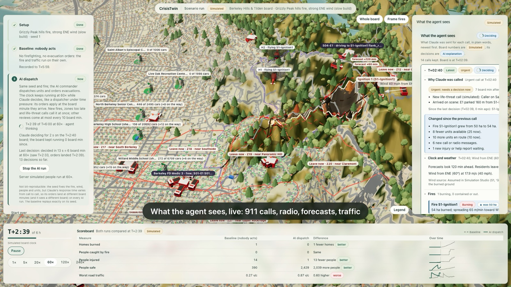
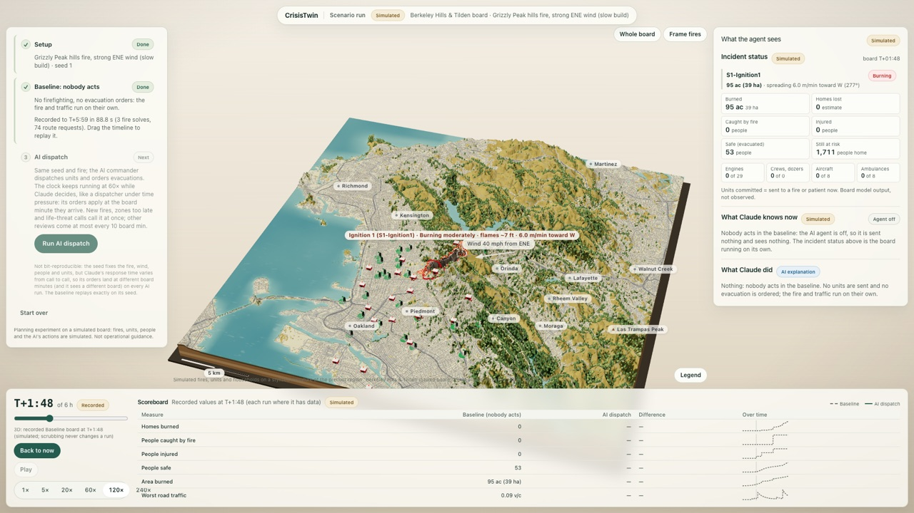
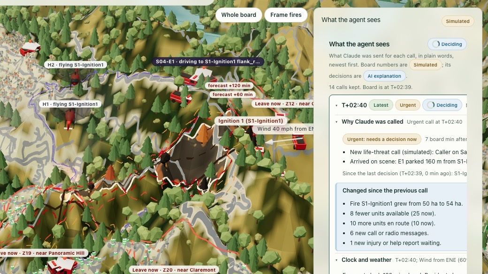
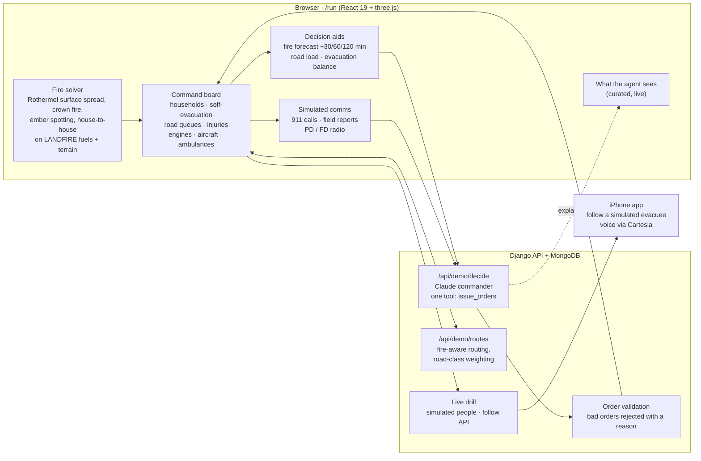

<div align="center">


### A digital twin of a wildfire response.

**Run a fire with nobody acting. Then hand command to an AI that looks ahead.<br>Same fire, same seed, scored side by side.**


[Why](#why-this-matters) · [What it does](#what-it-does) · [How it works](#how-it-works) · [How we built it](#how-we-built-it) · [Sponsor tracks](#sponsor-tracks) · [Quick start](#quick-start)



<sub>The single-view <code>/run</code> page: the fire, the roads, engines, aircraft and evacuees on a 3D Berkeley Hills board; what the AI sees on the right; the scoreboard against the no-action baseline below. Everything on it is a labelled simulation.</sub>

</div>

> [!IMPORTANT]
> CrisisTwin is an experimental **planning simulator**. Its fires, people, units and AI decisions
> are simulated; nothing it shows is an operational evacuation instruction, and it never contacts
> residents. Wind, moisture, demand and many other inputs are assumptions the pages label as such.

## Why this matters

- **Fires now outrun evacuations.** The 2018 Camp Fire reached Paradise within hours; 85 people
  died, some of them on roads that jammed as the fire arrived.
- **These hills have burned before.** The 1991 Oakland–Berkeley Hills fire killed 25 people and
  destroyed more than 3,000 homes, in the hills our demo board covers.
- **Dispatchers decide under pressure.** They work with partial information, minutes to spare, and
  roads that fill the moment people leave. An order given too late strands people. One given to
  everyone at once jams the only road out.

CrisisTwin lets the people who plan for that day rehearse it. Build a realistic fire on real
terrain, watch what happens if nobody acts, then see what a look-ahead commander does with the
same information, minute by minute.

## What it does

<table>
<tr>
<td width="33%" valign="top">

**1 · Set up**

Pick a curated Berkeley Hills fire (ignition, wind, fuel moisture), or tweak one. CrisisTwin
solves the fire on real terrain and fuels. It then builds the board: roads, fire stations with
their real fleets, safe areas away from the fire, and the households in its path.

</td>
<td width="33%" valign="top">

**2 · Baseline: nobody acts**

No firefighting, no evacuation orders. Residents leave only on their own cues: seeing the fire,
neighbours leaving, smoke and flames. The roads load up and people are caught. The page computes
all six hours in about a minute and a half, then lets you scrub back through them.

</td>
<td width="33%" valign="top">

**3 · AI dispatch**

The same fire and seed, with **Claude in command**. The clock keeps running while it thinks, like
a real dispatcher's. It orders evacuations in waves, routes each wave to a road and safe area
with room, and sends engines, aircraft and ambulances.

</td>
</tr>
</table>

A **scoreboard** compares the two runs at the same board minute, each measure with its curve over
time:
- homes burned;
- people caught by fire;
- people injured;
- people safe;
- acres burned;
- the worst road congestion.

**Drag the timeline to scrub either run:** the 3D board, the scoreboard and the incident status
all move to that minute.

**Fire you can read at a glance.** Each burning cell is drawn by its state:
- flaming, coloured by flame length using the firefighters' "hauling chart" bands (under 4 ft,
  hand crews can hold it; 4–8 ft, engines and dozers; 8–11 ft, aircraft; over 11 ft, out of
  control);
- crown fire;
- smouldering;
- burned out;
- put out by crews.

A contained fire turns blue. Every fire carries a plain-words label such as "Burning hard ·
flames ~9 ft · 65 m/min W", "Out · burned out".

Fires close realistically. A fire that runs out of fuel closes as *burned out* even with no crews,
and the preset offshore wind eases after a few hours. That gives crews a real chance later in the
run.

<p>


</p>

**The right panel, live.** It shows three things, top to bottom:

1. **Incident status**, in every phase:
   - each fire's state, acres, spread rate and heading;
   - homes lost, people caught, injured, safe and still at risk;
   - units committed.
2. **What Claude knows now**, the curated inputs of the latest call:
   - simulated 911 calls, civilian and first-responder field reports, and police and fire radio;
   - the models' forecasts: fire reach at +30/60/120 minutes per zone, and the load on each road;
   - why Claude was woken, e.g. a life-threat call, a new fire, or a zone running out of time.
3. **What Claude did**, newest first:
   - each order in plain words;
   - how long the decision took;
   - Claude's stated reason;
   - any order the server refused, with its reason.

The panel never scrolls sideways.

**One twin, many uses.** The same twin also runs:

| Use | Page | |
| --- | ---- | - |
| Plan before fire season | `/simulation` | Up to five scheduled fires, road and bridge closures, a staged-evacuation optimizer, and ground and air crews building control line. |
| Run a live drill | `/live` | Field-report triage, the drill clock, and an AI incident commander on a simulated command board. |
| Bring residents in | iOS app, `/app-integration` | Phones join the drill alongside hundreds of simulated people (not all of them obey orders). A participant can follow a simulated evacuee's drive on their own phone. Voice reports through Cartesia. |
| Learn from past fires | `/replay`, `/live/report` | Replays of the 2018 Camp, Marshall and Kincade fires with evacuation traffic, plus an after-action score for every drill. |
| Watch real incidents | `/intel` | An Apify Actor collects public agency pages; Claude extracts candidate closures and orders; a planner confirms each one. |

## How it works



**Design rules that keep the AI honest:**

- **Models compute every number; the LLM decides.** Fire arrival times, road loads, safe-start
  windows and evacuation schedules come from deterministic, sourced models. Claude chooses among
  them and explains itself; it never invents a figure.
- **One narrow tool.** Claude acts only through `issue_orders`:
  - evacuate a zone (now or at a later minute, by a chosen route to a chosen safe area), or cancel an evacuation;
  - send or release a crew, send a rescue to an injured person, or order aircraft and strike teams;
  - set a fire's strategy, close a road, or confirm a report.

  The server validates every order and returns a reason for each one it rejects.
- **Sourced or labelled.** Model parameters cite their source (Rothermel and Andrews fire behaviour,
  Hess 2015 road speeds, Wong et al. 2020 and Zhao et al. 2022 for self-evacuation, NIST TN 2174
  for night-time response, published department rosters for the fleets). Anything without a
  source is marked `ASSUMPTION` in the code. Every simulated value in the UI is tagged
  *Simulated*.
- **No resident data.** Homes and people on the board are synthetic.

## How we built it

CrisisTwin started as a set of separate tools: a fire spread model, a Simulation Studio, a
Claude dispatch agent, historical replays, a live-drill command page and an iOS resident app.
During Cal Hacks we joined them into one product: the single-view `/run` page, where setting up
a fire, running the no-action baseline and handing over to the AI all happen without leaving the
page.

**AI-assisted engineering, at scale.** We built `/run` with Claude Code acting as an
orchestrator:

1. **Contracts first.** The orchestrator wrote and froze the shared TypeScript contracts
   (`app/src/demo/runContracts.ts`) before any parallel work began.
2. **Two dozen parallel leads.** Lead agents worked side by side, each in its own git worktree, and
   many spawned their own subagents. Their areas were the page shell, run modes and scoring, the
   agent-inputs panel, simulated 911 and radio, injuries, forecasting, evacuation balancing, safe
   areas, road-class routing, real station fleets, 3D apparatus and aircraft, iOS follow, demo-seed
   curation, a fire-solver bug hunt, and the video tooling.
3. **Gated merges.** Each lead merged back into `feat/one-view` only after a TypeScript check, a
   production build and a Django system check passed.
4. **Shared rules for every agent.** [`AGENTS.md`](AGENTS.md) sets them: cite a source or label
   `ASSUMPTION`; label simulated and observed data; never let an LLM invent a computed number;
   pick the cheapest capable model (Haiku for mechanical work, Sonnet for routine work, Opus for
   maths and contracts).
5. **Curated, low-variance demo seeds.** A headless evaluation harness
   (`app/scripts/live-eval/evaluate.ts`) measured every candidate fire across seeds. We kept the
   ones where the decision aids beat no action every time ([docs/demo-seeds.md](docs/demo-seeds.md)).
6. **A resumable build log.** A running log of the build let a fresh session pick up where the
   last one stopped.

The demo video was recorded headlessly by an agent driving the real page through a Chrome
DevTools screencast. Its narration is Cartesia Sonic.

| | |
| --- | --- |
| Commits | 660+ |
| TypeScript / TSX (web app) | ~129k lines |
| Python (Django backend) | ~42k lines |
| Architecture decision records | 60+ in [`docs/adr/`](docs/adr/) |

## Sponsor tracks

| Track | How CrisisTwin uses it | Where |
| ----- | ---------------------- | ----- |
| **Anthropic** | See [the Claude section](#anthropic-claude) below: Claude is the incident commander, plus four other jobs. | [`api/demo.py`](app/backend/api/demo.py), [`api/dispatch.py`](app/backend/api/dispatch.py), [`api/live/voice.py`](app/backend/api/live/voice.py), [`agent/`](agent/README.md) |
| **Cartesia** · Best Use of Cartesia | See [the Cartesia section](#cartesia) below: voice is how a resident reports and gets guidance on a phone. | [`api/live/voice.py`](app/backend/api/live/voice.py), [`api/cartesia.py`](app/backend/api/cartesia.py), [Voice mode](#voice-mode-cartesia) |
| **Apify** · Best use of Apify, Best Actor | See [the Apify section](#apify) below: our own Actor gathers public incident pages. | [`actors/incident-intel/`](actors/incident-intel/README.md), [docs/incident-intel.md](docs/incident-intel.md) |
| **Microsoft** · Built for the Real World | See [the Microsoft section](#microsoft-built-for-the-real-world) below: a production-minded agent, scored against its own judging criteria. | [docs/deploy.md](docs/deploy.md), [`orchestrator_mcp/`](orchestrator_mcp/README.md) |
| **MLH** · Best Use of Gen AI | The Anthropic Claude API is the decision-maker, the voice understanding and the extraction engine across the product. | as above |
| **Cal Hacks** · Most Technically Complex, People-First, Planet-First | See [the Cal Hacks section](#cal-hacks-general-tracks) below: one fire twin coupled to traffic, people and an AI commander. | this repository |

### Anthropic (Claude)

Claude is the **incident commander** on `/run` and `/live`.
- It reads a curated observation (simulated 911 calls, radio, field reports, model forecasts).
- It acts only through the validated `issue_orders` tool.
- It uses prompt caching and a lower effort for routine reviews.

Claude also has four other jobs:
- the `/dispatch` agent;
- voice understanding on the phone;
- extracting incident facts from agency pages;
- drafting advisories in the fire-watch agent.

**Who it's for:** dispatchers and evacuation planners in California's wildland–urban interface,
starting with the Berkeley–Oakland hills.

**Where it can go wrong, and what guards it:**

| Risk | Guard |
| ---- | ----- |
| It can act late (the clock keeps running while it thinks). | Urgent events wake it at once. |
| It can over-evacuate and load roads. | The scoreboard shows the worst road's volume-to-capacity ratio. |
| It can trust an unconfirmed call. | Reports carry their confirmation status. |
| It can issue an invalid order. | The server rejects it with a reason. |

### Cartesia

Voice is how a resident on a phone reports a blocked road, checks in, or asks what to do. It is
especially useful hands-free while driving. Cartesia provides:
- streaming speech-to-text (`ink-2`) with keyterm boosts from the incident's own road names;
- streaming text-to-speech (Sonic `sonic-3.6`);
- short-lived tokens, so the API key stays on the server;
- batch fallbacks (`ink-whisper`, Sonic).

### Apify

`actors/incident-intel` is our own Actor. In **archive** mode it reads Wayback Machine captures;
in **live** mode it respects robots.txt. Claude extracts candidate closures, orders and shelters,
each with a verbatim quote. Every record stays *unconfirmed* until a planner checks it.

### Microsoft (Built for the Real World)

A production-minded agent, against the track's criteria:

| Criterion | How CrisisTwin meets it |
| --------- | ----------------------- |
| Customer understanding | It is built for dispatchers and evacuation planners. |
| Measurable usefulness | A scoreboard compares the AI with the baseline on the same seed. |
| Path to production | A Django and MongoDB service, a single-VM deploy recipe, a controller MCP server for external agents, and multi-phone drills. |
| Responsible design | Labels on everything simulated, no resident data, validated orders and human-confirmed intel. |
| End-to-end functionality | It works from setup to scoreboard to phone. |

### Cal Hacks (general tracks)

- **Most Technically Complex:** one twin couples a physics-based fire model, a traffic model, a
  sourced model of how people behave, real fire fleets, an LLM commander, a web 3D board and an
  iOS app.
- **People-First:** its purpose is getting people out alive.
- **Planet-First:** wildfire resilience in a warming climate.

MongoDB Atlas holds the app's data (landscapes, incident packages, run journals, drill state).

## All pages

<details>
<summary>Routes of the web app (<code>app/src/main.tsx</code>, <code>app/src/navigation.ts</code>); <code>/</code> redirects to <code>/fire</code></summary>

| Route | Page | What it does |
| ----- | ---- | ------------ |
| `/run` | Scenario run | The single-view page. Set up a curated Berkeley Hills fire, run the no-action baseline, then the AI dispatch step on the same seed. It shows a 3D board, what the agent sees, and a scoreboard against the baseline. It has no sidebar, so the steps never reload. Seeds: [docs/demo-seeds.md](docs/demo-seeds.md). |
| `/fire` | Fire spread model | Rothermel surface spread with crown fire, ember spotting and structure-to-structure spread, on LANDFIRE fuels, canopy and terrain. Views: a 3D diorama or USGS imagery. Areas: 13 prebuilt regions (11 in the San Francisco Bay Area, 2 in Los Angeles) or a live custom area. Optional NWS wind. [Reference](docs/fire-simulator.md). |
| `/simulation` | Simulation Studio | Up to five scheduled ignitions in one solver pass, solved in a Web Worker. JSON export and import, and a 3D diorama of the last run. **Evacuation & closures** evacuates the synthetic households and compares runs with and without road or bridge closures. An **optimizer** searches exits and staged waves. **Firefighters** sends hand crews, engines, dozers and aircraft to build control line. [ADR 0011](docs/adr/0011-simulation-studio.md), [ADR 0018](docs/adr/0018-road-closures.md), [ADR 0020](docs/adr/0020-studio-firefighting.md), [ADR 0048](docs/adr/0048-suppression-engine.md). |
| `/dispatch` | Dispatch agent | Studio with a live Claude dispatcher beside it (needs `ANTHROPIC_API_KEY`). It orders zones out or stages them in waves, and sends engines to fight a fire or to support an evacuation. It picks a tactic from options the simulator has solved. Runs are journalled in MongoDB Atlas and shown to the agent as lessons. [ADR 0014](docs/adr/0014-dispatch-agent.md), [ADR 0022](docs/adr/0022-dispatch-fire-attack.md), [ADR 0031](docs/adr/0031-dispatch-run-memory.md). |
| `/live` | Live command | The controller workspace for the active live drill. It has field-report triage, the drill clock and the real-time twin. Beside them is a simulated command board with an AI incident commander, off by default (**AI monitoring**). [Contract](docs/live-reports.md), [ADR 0047](docs/adr/0047-command-demo.md). |
| `/app-integration` | App integration | The phone app inside the live drill, in real time. Every joined phone and every simulated person appears on one map. The page shows what waits for the controller's OK, one message timeline, and what a chosen person's phone shows. [Doc](docs/app-integration.md). |
| `/live/report` | After-action report | Drill score with its breakdown, per-zone timing, triage and help times, and the decision timeline. Export as JSON. [Contract](docs/live-reports.md#after-action-report). |
| `/replay` | Historical replay | Replays of past fires (Camp 2018, Marshall, Kincade) with perimeters, evacuation traffic and responder or evacuee views. [Bundle contract](docs/replay-bundle.md). |
| `/intel` | Incident intelligence | An Apify Actor fetches public agency pages; Claude extracts candidate closures, orders and shelter updates with a verbatim quote; a planner confirms and maps each one. [Contract](docs/incident-intel.md), [ADR 0018](docs/adr/0018-apify-incident-intelligence.md). |
| `/simulate` | Agent simulation | Replay-style view of simulated agent runs. |
| `/diorama` | Evacuation diorama | A fictional, scripted ~90 s three.js evacuation of a made-up town. [ADR 0010](docs/adr/0010-evacuation-diorama.md). |
| `/comparison`, `/stress-tests` | Planning pages | UI scaffolds with temporary local input. [Details](docs/workspace-pages.md). |

Also in the repository:

- **Backend** (`app/backend/`): Django REST API.
  - Fire data: landscapes, a LANDFIRE and terrain tile cache, and OSM roads and stations.
  - Agents: the dispatch and command-demo agents.
  - Live drill: drill, twin and simulated-people APIs, and the shared world.
  - Mobile: the mobile data store.
  - [API contract](app/backend/README.md).
- **iOS app** (`mobile/`): SwiftUI resident app for the live drill.
  - It shows the fire estimate and zone guidance, takes field reports and check-ins, and offers voice mode.
  - It has family meeting points.
  - A participant can **follow a simulated person** on the Map.
  - [README](mobile/README.md).
- **Fire watch agent** (`agent/`): drafts evacuation advisories from satellite detections for a
  human to approve. [README](agent/README.md).
- **Controller MCP server** (`orchestrator_mcp/`): lets an external agent act as the drill's
  controller, with every write attributed to the agent. [README](orchestrator_mcp/README.md).
- **Historical replay simulator** (`sim/`): stdlib Python fire hindcast and evacuation traffic
  model. [README](sim/README.md).
- **Live scenario runner** and **simulated people**: fill a drill with simulated residents, 911,
  radio and rescue calls. [Doc](docs/live-scenario-runner.md), [Doc](docs/app-integration.md#simulated-people).

</details>

## Known limitations

- The fire model is **unvalidated at demo settings**. It may under-predict how fast fire spreads
  from house to house in a wind-driven urban fire. The 1991 fire destroyed far more homes in its
  first hour than our board does.
- **AI runs are not bit-reproducible.** The seed fixes the fire, wind, people and units, but
  Claude's response time varies, so its orders land at different board minutes. The baseline
  replays exactly.
- The **headless harness and the page can differ**. The demo seeds were measured headlessly, and
  a run on the page can give other numbers.
- **Some inputs are unverified.**
  - Mutual-aid lead times are `ASSUMPTION`.
  - Some department rosters (Moraga-Orinda, Con Fire, Albany, Richmond) are not verified.
  - Drills outside Camp get 0% road grade.
- **iOS voice and follow mode have not been tested on a physical device.**
- **The demo presets' easing wind is an `ASSUMPTION`.** Each holds its offshore wind until
  T+2:30, then drops to 12 mph; fuel goes from critical to dry at T+4:00. Their harness numbers
  were measured before this change and are marked stale in `app/src/oneview/demoSeeds.ts` until
  they are re-measured.
- **The fast baseline waits on the route service.** A 6-hour baseline takes about 85–90 s on the
  dev server, almost all of it routing requests.
- **Smouldering and "creeping" are labelled assumptions.** Smouldering is shown for a 60-minute
  window, and "creeping" means under 2 m/min.
- **Not modelled yet:** aircraft grounding at night or in high wind.

## Quick start

Requirements: Docker with Compose v2 and a MongoDB connection (Atlas or local). Keep the
connection string in `~/.mongodb_uri` (permissions `600`). Your IP must be in the Atlas network
access list. Never commit or paste the connection string.

```sh
git clone https://github.com/ryankim0709/crisistwin.git
cd crisistwin/app
export MONGODB_URI="$(cat ~/.mongodb_uri)"
docker compose up --build --wait
```

Open **http://localhost:5173** (it redirects to `/fire`), or **http://localhost:5173/run** for the
single-view demo. The API health check is at **http://localhost:8000/api/health**. Frontend and
backend source changes reload automatically. Compose runs only the app processes; it does not
provision a database.

Alternatively, copy [`app/.env.example`](app/.env.example) to the ignored `app/.env`.
`MONGODB_URI` is required; `MONGODB_DATABASE` defaults to `crisistwin`. Do not share expanded
`docker compose config` output.

```sh
docker compose logs -f      # follow logs
docker compose down         # stop the stack
```

**AI commander and dispatch agent.** Set `ANTHROPIC_API_KEY` in the backend environment; without
it the endpoints return 503. Optional settings:
- `DISPATCH_AGENT_MODEL` and `DISPATCH_AGENT_EFFORT`;
- `DISPATCH_AGENT_ROUTINE_EFFORT` and `DISPATCH_AGENT_ROUTINE_MODEL`, for routine continuous reviews.

Per-call token usage and cost print in `docker compose logs backend` (`Decision usage: …`) and on
the page. The dispatch area endpoint needs internet the first time a box is used; results are
cached.

**Scenario resource snapshots.** These are the households, fire stations and engines at T+0 of
each live drill ([docs/scenario-snapshots.md](docs/scenario-snapshots.md)). Create them once per
database, and again after changing `tools/snapshot_assumptions.json`:

```sh
docker exec crisistwin-backend-1 python manage.py live_init_db          # collections + validators
docker exec crisistwin-backend-1 python manage.py live_seed_snapshots   # Camp, Berkeley Hills, Palisades
```

**Other requirements.**
- The `/fire` page needs internet access (LANDFIRE, terrain tiles, NWS) and works in the
  contiguous US only.
- `/run` needs a Berkeley Hills & Tilden drill package. Its **Prepare** step builds and stores one
  if none exists.

Stack: Node 22.12+ with npm, Python 3.12, React 19, TypeScript 5.8, Vite 7, Tailwind CSS 4, three.js,
Django 5.2, DRF 3, PyMongo 4. Running on the host without Docker, checks, and runtime images:
[docs/development.md](docs/development.md).

### Data

Large incident-package files (`raw/`, `normalized/`) and generated replay bundles are not in Git;
they live in MongoDB Atlas. After cloning:

```sh
pip install -r tools/requirements.txt
export MONGODB_URI='mongodb+srv://...'   # ask a teammate; never commit it
python3 -m tools.mongo_data pull
python3 -m tools.mongo_data status       # drift vs the committed manifests
```

If `status` reports drift after you pull, the author has not yet run `record` and `push` and
committed the manifest. See [docs/historical-data.md](docs/historical-data.md) and
[tools/README.md](tools/README.md).

### iOS app

```sh
open mobile/CrisisTwin.xcodeproj
```

Select the **CrisisTwin** scheme and an iOS 26 simulator (Xcode 26), then choose Product > Run.
Debug builds use `http://localhost:8000/api/health`, so start the Docker stack for the readiness
card. Details: [mobile/README.md](mobile/README.md).

### Voice mode (Cartesia)

On the phone, a person can:
- report a blocked road or check in by voice;
- ask what to do, and get answers from the published guidance;
- in Drive mode, hear guidance changes read aloud.

Claude only interprets what was said and proposes one action, and the phone asks before it sends
anything. The model computes no route, time or hazard.

When Claude answers a question, it uses only the incident facts the server builds for that turn:
- the zone's published guidance and its recent versions;
- reported hazards and nearby shelters;
- the fire estimate.

It says when those facts do not cover the question. The phone shows which facts it used ("From:
published guidance · fire estimate"). The phone sends its zone id for this, never its
coordinates ([Grounded answers](docs/live-reports.md#grounded-answers)).

Cartesia supplies the speech:

- **Speech-to-text:** `ink-2`, streamed over a WebSocket, so the screen shows live captions while
  the person talks.
  - Up to 10 `keyterm` boosts come from the incident's own road and exit names, so "Pentz Road"
    is not heard as "Pence Road".
- **Text-to-speech:** Sonic (`sonic-3.6`), streamed over a WebSocket.
  - Reply text is sent in continuations as the model writes it, so audio starts before the reply
    is finished.
  - Guidance announcements in Drive mode use the `calm` emotion and a slightly lower speed.
- **Short-lived access tokens:** the server mints a 300 s token with only speech-to-text and
  text-to-speech grants (`POST /api/live/incidents/{id}/voice/token`). The phone talks to
  Cartesia directly, and the `CARTESIA_API_KEY` stays on the server.
- **Batch endpoints:** `/stt` and `/tts/bytes` remain as the non-streaming path (a recorded WAV
  in, a WAV reply out).

Optionally, TypeSafe's Jev model classifies each utterance first, as a typed question with
calibrated probabilities.
- A confident first-hand hazard report is filed without asking, and the person can undo it within
  5 minutes.
- Everything else is confirmed first.
- Without `TYPESAFE_API_KEY`, Claude handles every turn.

See [docs/live-reports.md](docs/live-reports.md#decisions-jev).

Measured on the local stack, the first reply text arrives about 3.2 s after the transcript is
posted. The whole reply takes about 3.7 s, against about 6.8 s without streaming. These figures
cover the model call only; they were not timed on a phone.

**Setup.** Put `CARTESIA_API_KEY` (and `ANTHROPIC_API_KEY`) in the ignored `app/.env`. Optional
settings: `CARTESIA_VOICE_ID`, `CARTESIA_TTS_MODEL`, `VOICE_MODEL`, `TYPESAFE_API_KEY` and
`JEV_MODEL`. Then run `cd app && docker compose up -d backend`.

Both services are paid usage. Without the keys, the token endpoint answers 503
`voice_unavailable`, and the phone falls back to typed input and on-device speech.
- Wire contract: [docs/live-reports.md](docs/live-reports.md#voice-mode).
- curl examples: [`app/backend/README.md`](app/backend/README.md#voice-mode-post-apiliveincidentsidvoice).
- Phone side: [mobile/README.md](mobile/README.md#voice).

**Known limitations:**
- English only.
- A report's location is the phone's GPS position, even when the person names another place.
- The Jev thresholds are not calibrated on labelled data.
- Speech needs a network signal.
- Barge-in on the speakerphone depends on Apple's echo cancellation.
- The iOS voice and Drive mode have not been run on a simulator or a device yet.

### Multi-phone drill

One backend and console serve several real phones from one iOS build. Phones get the server from
a join link, `crisistwin://join?server=<origin>&code=<invite>`. Open the link, or scan its QR code
in Plan > About > Server. The `/live` "..." menu > **Invite phones** shows the link and QR code
([ADR 0034](docs/adr/0034-multi-phone-hosting.md)). Always set `LIVE_CONTROLLER_TOKEN` (without it
every client is the controller) and `LIVE_INVITE_CODE`.

**(a) Same Wi-Fi, the Mac serves.** Find the Mac's name with `scutil --get LocalHostName`
(`<mac>.local`).
```sh
cd app
export LIVE_CONTROLLER_TOKEN=<token> LIVE_INVITE_CODE=<code>
CT_BIND_ADDR=0.0.0.0 DJANGO_ALLOWED_HOSTS=localhost,127.0.0.1,backend,<mac>.local docker compose up --build
```
Open `http://localhost:5173/live` on the Mac, choose Invite phones, and give the server
`http://<mac>.local:5173`.

**(b) HTTPS tunnel.**
1. Run `cloudflared tunnel --url http://localhost:5173`. It prints a hostname,
   `<name>.trycloudflare.com`.
2. Restart Compose with
   `DJANGO_ALLOWED_HOSTS=localhost,127.0.0.1,backend,<name>.trycloudflare.com VITE_ALLOWED_HOSTS=<name>.trycloudflare.com`.
3. Invite phones with that origin.

**(c) Cloud VM.** A ready-made single-VM stack is in `deploy/`; the steps are in
[docs/deploy.md](docs/deploy.md).

### Checks

The only default check is pre-commit (merge-conflict markers, trailing whitespace, final
newlines):

```sh
python3 -m pip install pre-commit
pre-commit run --all-files
```

Type checks and builds are optional and listed in [docs/development.md](docs/development.md).
There are no CI workflows.

## Repository map

```text
app/                  Web app
  src/                React 19 + TypeScript frontend (see app/AGENTS.md)
    oneview/          /run: the single-view scenario run (setup → baseline → AI dispatch)
    demo/             Command board: run modes, scoring, forecasts, evacuation balance, comms, injuries
    response/         Fire departments and fleets
    ui/               Design tokens and shared component kit: the UI standard, see app/src/ui/README.md
    fire/ studio/ dispatch/ replay/ diorama/ live/ appint/ pages/ maps/ lib/
  backend/            Django 5.2 REST API + PyMongo (config/, api/, livecore/ live-drill rules and planner)
  scripts/live-eval/  Headless evaluation harness for the command board
  public/             Static assets (brand logo, map imagery; replay bundles are generated)
  data-manifest.json  Hashes of generated app data stored in MongoDB Atlas
  docker-compose.yml  Development stack (frontend + backend, external MongoDB)
actors/incident-intel/ Apify Actor for public incident pages
agent/                Fire watch agent (Anthropic SDK, standalone)
orchestrator_mcp/     Controller MCP server for an external orchestrator agent (standalone)
sim/                  Historical replay simulator (stdlib Python)
tools/                Data acquisition and sync scripts (see tools/README.md)
tests/                Unit tests for the tools incident builders
data/incidents/       Incident packages; manifests in Git, bytes in MongoDB Atlas
mobile/               Native iOS app (Xcode project)
docs/                 Docs index: docs/README.md; decisions: docs/adr/
AGENTS.md             Shared rules for coding agents (CLAUDE.md, Cursor and Copilot adapt it)
```

## Documentation

- [docs/README.md](docs/README.md): index of all docs. [Project scope](docs/project-scope.md) (proposals, not status).
- [docs/adr/](docs/adr/): architecture decisions. Some numbers repeat, so cite them by full file name.
- [docs/demo-seeds.md](docs/demo-seeds.md): how the `/run` presets were chosen and measured.
- [app/src/ui/README.md](app/src/ui/README.md): the UI standard.
- [AGENTS.md](AGENTS.md) and [app/AGENTS.md](app/AGENTS.md): rules for coding agents.
- Component READMEs: [app/backend](app/backend/README.md), [agent](agent/README.md),
  [orchestrator_mcp](orchestrator_mcp/README.md), [sim](sim/README.md),
  [tools](tools/README.md), [mobile](mobile/README.md), [actors/incident-intel](actors/incident-intel/README.md).

<div align="center"><sub>Built at Cal Hacks 13.0 · A simulated planning experiment, not operational guidance.</sub></div>
